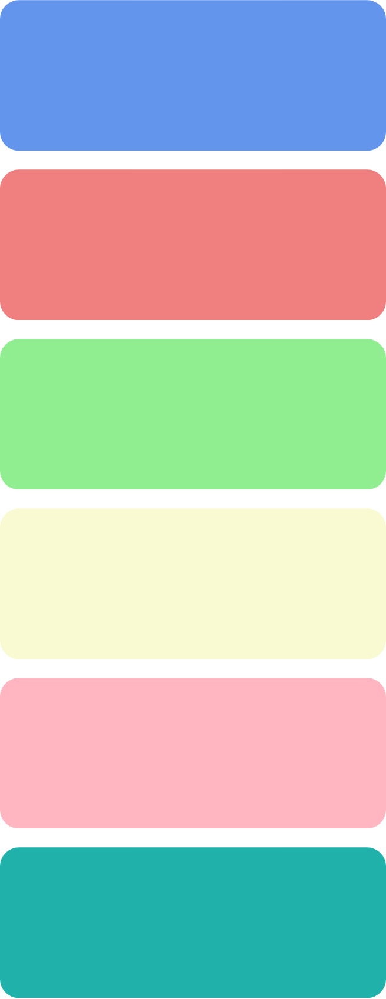
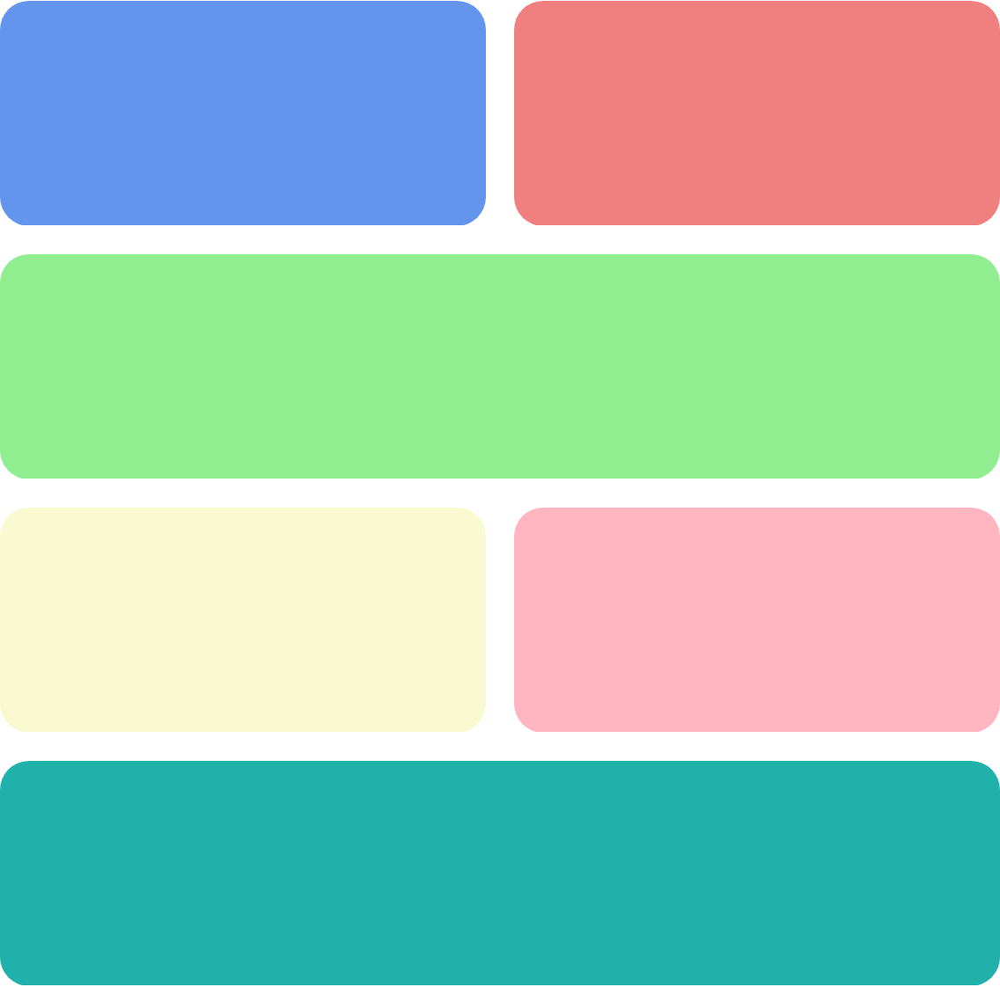
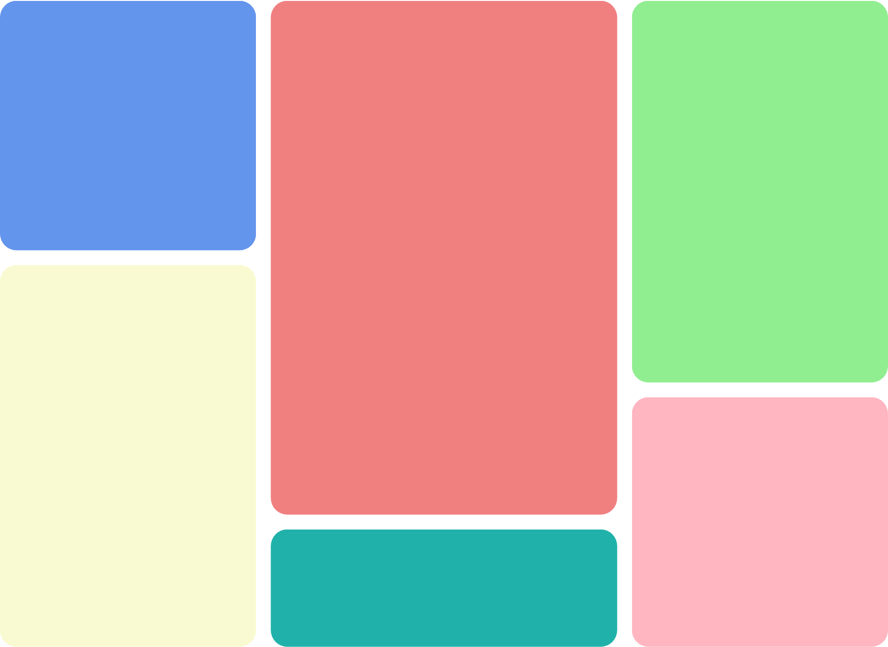
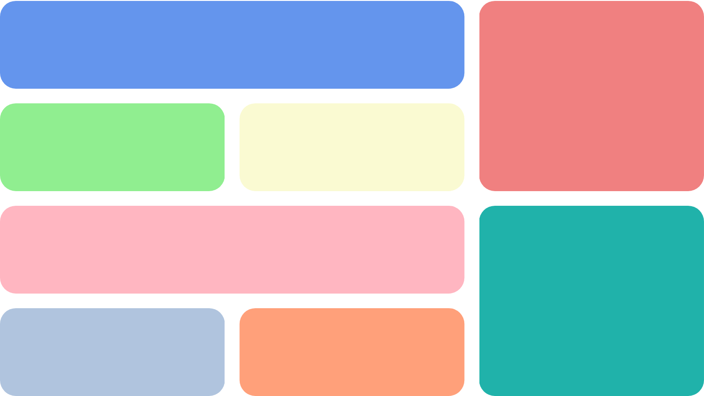
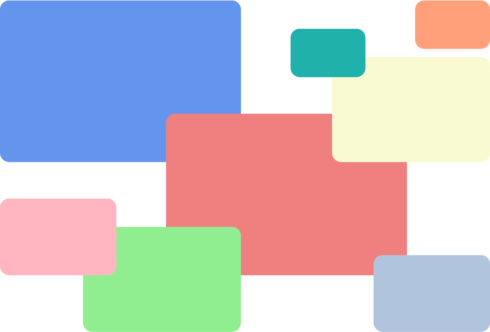

# 3. Breakpoints: a different layout at every width

Most responsive grids change one thing as the screen grows: the number of columns, such as
1, then 2, then 3. That works for a list of equal items. It works less well for a front page,
where the first story should be big on a desktop, a gallery that should feel editorial, or
a product row where one item deserves extra attention.

The layout system treats each breakpoint as its own design. Every breakpoint attribute can
hold a **completely different layout**, and the same children flow into it.

## One element, three designs

```html
<lay-out sm="columns(2)" md="grid(3a)" lg="bento(6a)">
  <!-- six items -->
</lay-out>
```

| Below 380px: no attribute applies, so the items stack | 540px to 719px: `md="grid(3a)"` |
|---|---|
|  |  |

From 720px, `lg="bento(6a)"` takes over:



*Screenshots: [`bento.html`](https://v4.browser.style/layout/dist/bento.html), second example, at 360px, 600px and 1000px.*

Nothing in the markup changed between these three pictures. Each breakpoint swaps in a new
arrangement:

- **Phones** get one readable column.
- **Tablets** get a rhythm of two small items and one wide item.
- **Desktops** get a bento box with a clear lead item.

## A bigger jump: from grid to mosaic

Layouts aren't limited to rows and columns. Here a regular grid becomes an overlapping
mosaic once there is room for it:

```html
<lay-out md="columns(2)" lg="grid(4c)" xl="mosaic(scatter)">
```

| 800px: `lg="grid(4c)"` | 1000px: `xl="mosaic(scatter)"` |
|---|---|
|  |  |

*Screenshots: [`mosaic.html`](https://v4.browser.style/layout/dist/mosaic.html), second example.*

## Why this is worth having

**Each screen size gets a design, not a squeeze.** A layout built for a desktop rarely
shrinks well, and a phone layout rarely stretches well. Choosing per breakpoint lets you
design for each width instead of compromising between them.

**Content stays in reading order.** The HTML order is the order on a phone and for screen
readers. Bigger layouts move items around visually with grid placement, but the document
order never changes, so there's nothing to keep in sync.

**No duplicate markup.** You don't hide a "desktop version" and show a "mobile version".
It's the same elements, arranged differently.

**It's declarative.** `md="grid(3a)"` says *what* you want. The *how* (grid templates,
spans and areas for each child) lives in the layout definition, tested once and reused
everywhere.

## How breakpoints combine

- **Mobile-first, cumulative.** A breakpoint applies from its width upward until a larger
  one overrides it. `md="columns(2)"` alone means two columns at 540px *and every width
  above it*.
- **No attribute means a single column.** Without a layout token, a `<lay-out>` is a
  one-column grid.
- **Only the layout is replaced.** When `lg` sets a new layout, the item placement from
  `md` is reset first, so `bento(6a)` never inherits a span from `grid(3a)`. Spacing tokens
  carry on until another breakpoint changes them.
- **A spacing-only value keeps the layout.** `md="grid(3a)" lg="cg(2)"` keeps the `md` grid
  at `lg` and only changes the column gap. The reset happens only when the larger
  breakpoint names a new layout.
- **One layout per attribute.** Put one layout token in each breakpoint attribute. Spacing
  and the other tokens can sit next to it: `lg="bento(6a) cg(2) pb(3)"`.

## Viewport, not container

The six breakpoints are **viewport** widths. A `<lay-out>` inside a sidebar still switches
at the page's breakpoints, not at the sidebar's width. That keeps every section on a page in
step with the others.

> **Components that adapt to their own width.** Cards from `@browser.style/card` have their
> own `md:` and `lg:` prefixes, and those are *container* queries against the card's width.
> The two systems are designed to work together: the layout decides how wide each cell is,
> and the card adapts to that cell. See
> [`docs/card-integration.md`](card-integration.md).

Next: [The layouts →](04-layouts.md)
