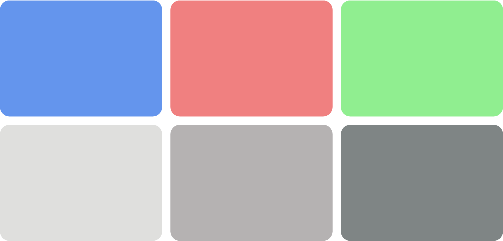
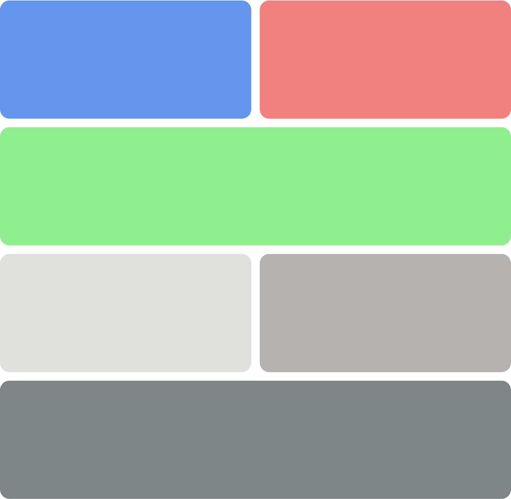
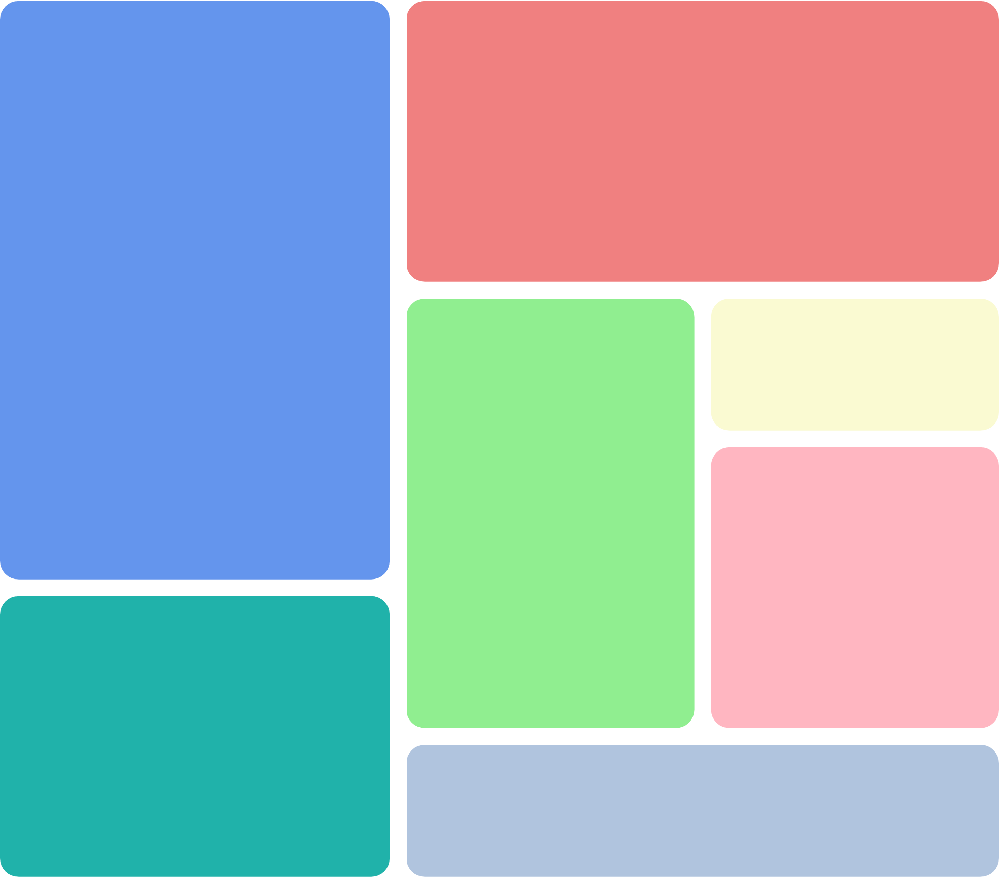
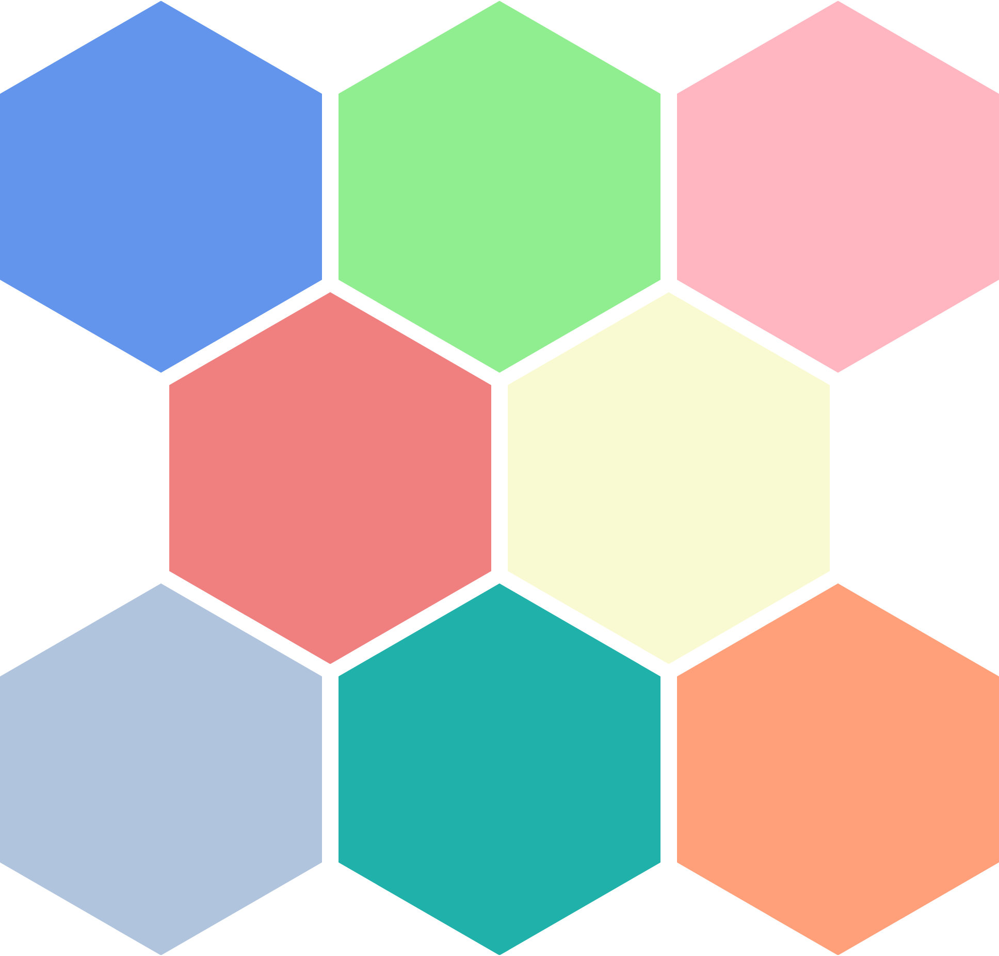
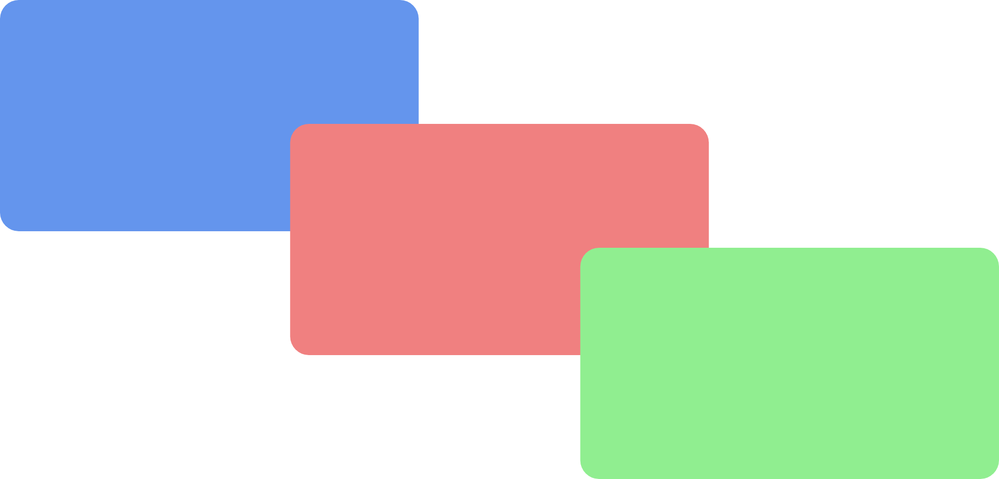
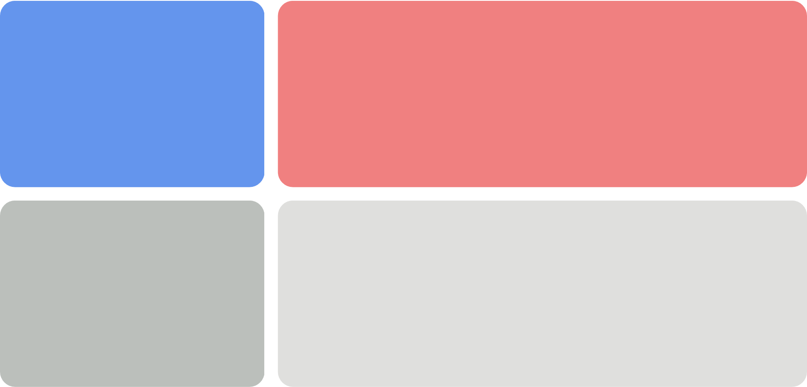
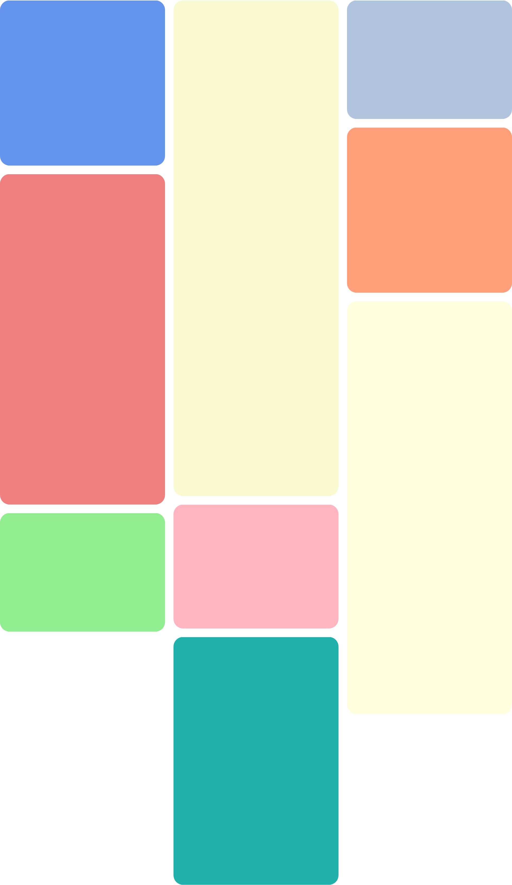
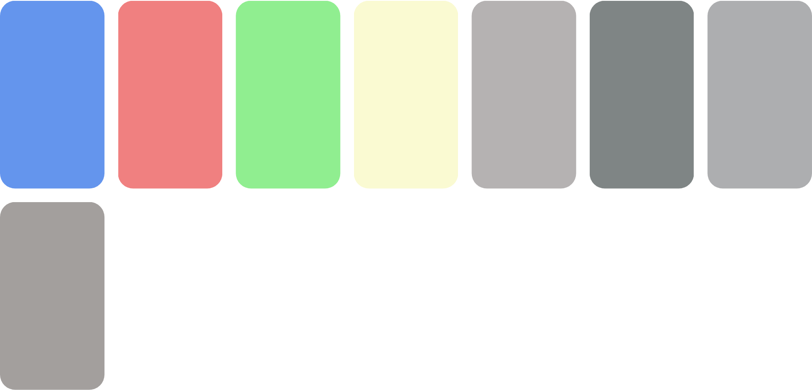
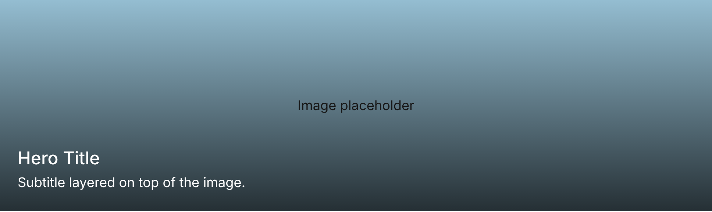

# 4. The layouts

Every layout token has the form `family(variant)`, like `columns(3)`, `grid(3a)` or
`bento(6a)`. There are nine families. Each section below shows one variant, and the matching
demo page shows all of them, with an icon for each.

| Family | Variants | Use it for | Demo |
|---|---|---|---|
| `columns()` | `1`–`6` | Equal columns | [`columns.html`](https://v4.browser.style/layout/dist/columns.html) |
| `grid()` | 19 (`3a`–`6b`) | Small patterns with one or two wide or tall items | [`grid.html`](https://v4.browser.style/layout/dist/grid.html) |
| `bento()` | 10 (`4a`–`9b`) | Fixed patterns with a lead item | [`bento.html`](https://v4.browser.style/layout/dist/bento.html) |
| `mosaic()` | `photo` `scatter` `hex` `pinwheel` `cornerstone` | Editorial and gallery arrangements, some overlapping | [`mosaic.html`](https://v4.browser.style/layout/dist/mosaic.html) |
| `asym()` | `l-r` `r-l` `t-b` `b-t` `tl-br` `bl-tr` | Two or three items, offset against each other | [`asymmetrical.html`](https://v4.browser.style/layout/dist/asymmetrical.html) |
| `ratio()` | `25:75` `33:66` `40:60` `60:40` `66:33` `75:25` `25:25:50` `25:50:25` `50:25:25` | Columns with fixed proportions, such as a sidebar and main content | [`ratios.html`](https://v4.browser.style/layout/dist/ratios.html) |
| `lanes()` | `auto` `2`–`6` | Masonry: columns of items with different heights | [`lanes.html`](https://v4.browser.style/layout/dist/lanes.html) |
| `auto()` | `fit` `fill` | As many columns as fit, with no breakpoints needed | [`autofit.html`](https://v4.browser.style/layout/dist/autofit.html) |
| `stack()` | any name | Children layered on top of each other | [`stack.html`](https://v4.browser.style/layout/dist/stack.html) |

The patterned families (`grid`, `bento`, `mosaic`, `asym`) are designed for a certain number
of items, which is the number in their name. Extra items wrap into the next row and repeat
the pattern where that makes sense.

## Columns

Equal-width columns, from one to six. Items fill the columns row by row.

```html
<lay-out md="columns(2)" lg="columns(3)">
```



The columns are truly equal. One item with long, unbreakable content can't push its column
wider than the others.

## Grid

Small patterns built on a two- or three-column grid, where one or two items span more than
one cell. The number gives the item count, and the letter picks the pattern: `grid(3a)` is
two small items and one wide item below them, and `grid(3c)` is one tall item with two
small ones next to it.

```html
<lay-out md="columns(3)" lg="grid(3a)">
```



## Bento

Fixed patterns with a clear hierarchy, named after the compartments of a bento box. Bento
layouts work best when you have exactly the number of items in the name.

```html
<lay-out md="columns(3)" lg="bento(7b)">
```



## Mosaic

Arrangements that break the grid: `scatter` overlaps items, and `hex` clips items into
hexagons. They're best used at wide breakpoints, with a simpler layout below.

```html
<lay-out md="columns(2)" lg="grid(4d)" xl="mosaic(hex)">
```



## Asymmetrical

Two or three items, deliberately offset against each other. For example, `tl-br` runs from
top-left to bottom-right. This works well for an image and its text, or for a pair of
teasers.

```html
<lay-out md="columns(3)" lg="asym(tl-br)">
```



## Ratio

Columns with fixed proportions. `ratio(33:66)` is a classic sidebar and main column, and
`ratio(25:50:25)` puts the main content between two sidebars.

```html
<lay-out md="columns(2)" lg="ratio(33:66)">
```



## Lanes (masonry)

Columns where each item keeps its own height, and the next item goes into whichever lane
is shortest. `lanes(2)` to `lanes(6)` set the number of lanes. `lanes(auto)` fits as many
lanes as there is room for, using the `lanes-min` attribute (default `10rem`) as the minimum
lane width.

```html
<lay-out sm="lanes(2)" lg="lanes(3)">
<lay-out sm="lanes(auto)" lanes-min="12rem">
```



Safari uses native CSS masonry (`display: grid-lanes`). Chrome uses a CSS columns fallback
that produces the same number of lanes.

## Auto

`auto(fit)` and `auto(fill)` create as many columns as fit, so they need no breakpoint
switching. `fit` stretches the items to use the full width, and `fill` keeps empty column
slots at the end of the row.

```html
<lay-out sm="auto(fit)">
```



## Stack

`stack()` puts every child in the same grid cell, so they sit on top of each other. Later
children are painted on top, and the tallest child sets the height. The name in brackets is
yours to choose (`stack(hero)`, `stack(card)`), and they all behave the same way.

```html
<lay-out xs="stack(hero)">
  <div class="image">…</div>
  <div class="text">…</div>
</lay-out>
```



`stack(reveal)` is the one reserved name: it adds a sticky, scroll-driven reveal. See
[Animations](08-animations.md#reveal-layers-with-stackreveal).

## Other layout attributes

These work alongside any layout:

| Attribute or token | What it does |
|---|---|
| `items(start\|center\|end\|stretch)` | Aligns items vertically within their row, per breakpoint: `lg="columns(2) items(start)"` |
| `items(fill)` | Lets the first card set the row height and makes the others fill it |
| `subgrid` + `subgrid="N"` | Lines up the inner rows of cards (image, title, text) across a row: `subgrid="3" md="columns(3) subgrid"` |
| `gap-decorations="cols rows"` | Draws lines in the gaps (see [Spacing](05-spacing.md#lines-in-the-gaps)) |
| `columns="…"` and `rows="…"` | Your own grid templates, when no named layout fits |

You can also add your own layout families. See
[Configuration](10-configuration.md#adding-your-own-layouts).

Next: [Spacing →](05-spacing.md)
