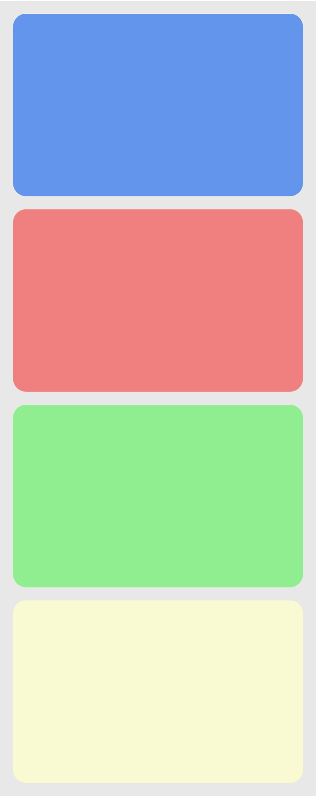
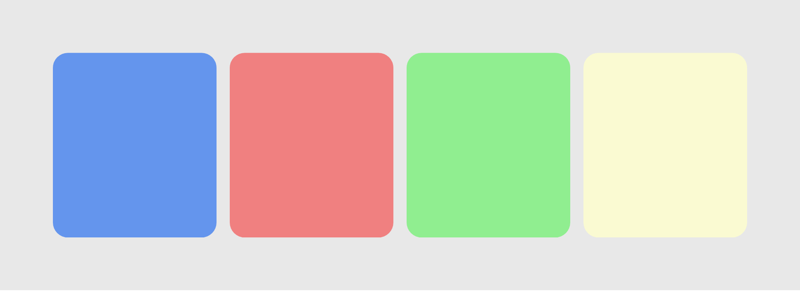
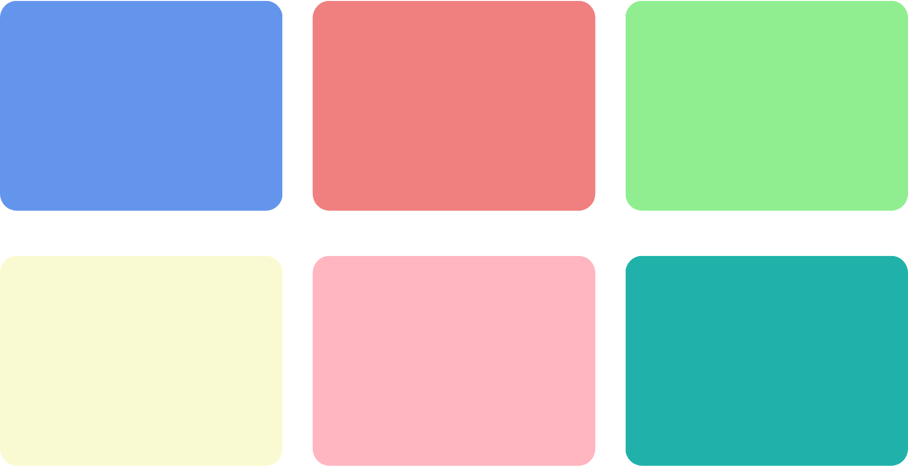
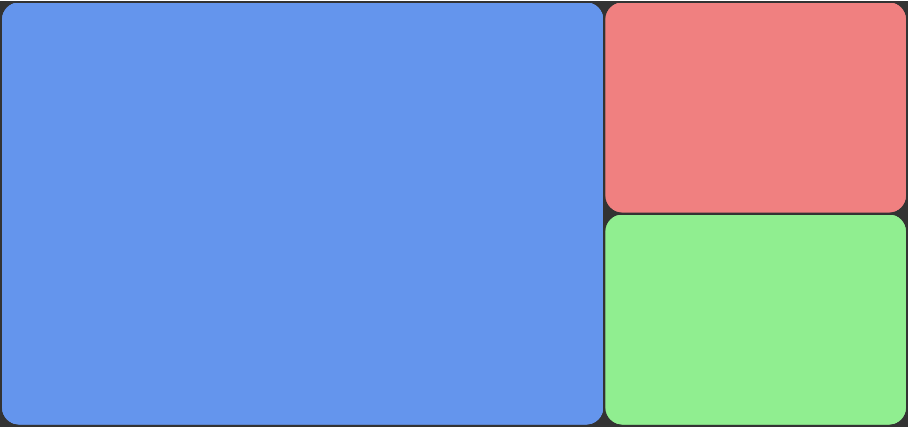
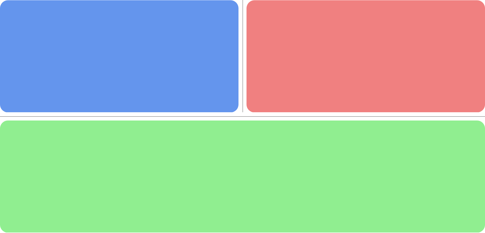

# 5. Spacing: padding, margins and gaps

Spacing uses the same breakpoint attributes as the layouts. Each spacing token is a short
name with a size in brackets, and you can mix spacing and layout tokens freely:

```html
<lay-out xs="p(1)" lg="columns(4) p(4)">
```

*"One unit of padding everywhere; from 720px, four columns and four units of padding."*

## The tokens

| Token | Sets | Default |
|---|---|---|
| `p(N)` | Padding on all four sides | 0 |
| `pi(N)` | Padding left and right (inline) | 0 |
| `pb(N)` | Padding top and bottom (block) | 0 |
| `pbs(N)` | Padding at the top (block start) | 0 |
| `pbe(N)` | Padding at the bottom (block end) | 0 |
| `mbs(N)` | Margin above (block start) | 0 |
| `mbe(N)` | Margin below (block end) | 0 |
| `cg(N)` | Gap between columns (column gap) | 1 |
| `rg(N)` | Gap between rows (row gap) | 1 |

All tokens use **logical** directions, so "inline" follows the text direction and
right-to-left pages need no extra rules. There's no inline margin token, because the inline
margins are reserved for centring the layout.

## The scale

`N` is a multiplier of `--layout-space-unit`, which is `1rem` by default. You can write it as
a number or as a size word, and both spellings can be mixed:

| Number | Size | Word | Size |
|---|---|---|---|
| `0` | none | `3xs` | 0.0625 (1px) |
| `0.75` | 0.75rem | `2xs` | 0.125 (2px) |
| `1` | 1rem | `xs` | 0.25 (4px) |
| `2` | 2rem | `sm` | 0.5 (8px) |
| `3` | 3rem | `md` | 1 (16px) |
| `4` | 4rem | `lg` | 1.5 (24px) |
| | | `xl` | 2 (32px) |
| | | `2xl` | 3 (48px) |

The words cover the small end of the scale that whole numbers can't reach: `cg(xs)` is a
tight 4px gutter, and `cg(2xs)` is a 2px hairline. Change `--layout-space-unit` on a
`<lay-out>` to scale all of its spacing at once.

## Padding

`p()` pads all sides. Set a small value at `xs` and a larger one at `lg`, and the padding
grows with the screen:

```html
<lay-out xs="columns(2) p(1)" lg="columns(4) p(4)" style="--layout-bg: #e8e8e8">
```

| 420px: `p(1)` | 1000px: `p(4)` |
|---|---|
|  |  |

*Screenshots: `dist/spacing.html`, first example. The grey is `--layout-bg`, which shows
where the padding is.*

Use `pi()` and `pb()` to set the two axes separately, and `pbs()` and `pbe()` when the top
and bottom should differ:

```html
<lay-out xs="columns(2) pbs(1) pbe(2)" lg="columns(3) pbs(2) pbe(4)">
```


## Gaps

Every layout has a 1-unit gap between its columns and rows by default. `cg()` and `rg()`
change them separately:

```html
<lay-out xs="columns(2) cg(1) rg(1)" lg="columns(3) cg(2) rg(3)">
```



Use `0` to close the gaps completely:

```html
<lay-out xs="columns(3) cg(0) rg(0)" lg="columns(4) cg(0) rg(0)">
```


### Hairlines

Combine tiny gaps with a background colour and you get thin dividing lines, made from the
background showing through:

```html
<lay-out xs="columns(2) cg(2xs) rg(2xs) p(2xs)" lg="grid(3c) cg(2xs) rg(2xs) p(2xs)"
         style="--layout-bg: #333">
```



### Lines in the gaps

For real rules in the gaps, without a background, use `gap-decorations` with `cols`,
`rows` or both:

```html
<lay-out lg="grid(3a)" gap-decorations="cols rows">
```



The line's width, style and colour come from `--layout-rule-w`, `--layout-rule-s` and
`--layout-rule-c`.

## Margins

`mbs()` and `mbe()` add space above and below a single section. To space *all* sections the
same way, use the page gap below instead.

## Space between sections

Mark the element that directly contains your sections, usually `<body>` or `<main>`, with
`data-layout-root`. It becomes a one-column grid, and `data-page-gap` sets the gap between
its children in spacing units:

```html
<body data-layout-root data-page-gap="2">
  <h1>…</h1>
  <lay-out md="columns(2)">…</lay-out>
  <lay-out md="columns(3)">…</lay-out>
</body>
```

Only direct children are spaced, so layouts nested inside cards or carousels aren't
affected. To set the gap for a whole site, use `:root { --layout-page-gap: 3rem }`.

## Spacing changes per breakpoint

Like layouts, spacing tokens apply from their breakpoint upward. Here the gap shrinks to a
hairline when the layout becomes a grid:

```html
<lay-out xs="columns(2) cg(sm) rg(sm)" lg="grid(3a) cg(2xs) rg(2xs)">
```

> **Which breakpoints have spacing?** Spacing tokens are generated only at the breakpoints
> listed in the config. The default build has them at `xs` and `lg`, which covers "phone"
> and "desktop". A site build can add more, or include only the tokens and sizes the site
> uses. See [Configuration](10-configuration.md#spacing). `lg="cg(2)"` on a build without
> `lg` spacing does nothing, and the `--check` command reports it.

Next: [Bleed and widths →](06-bleed-and-widths.md)
