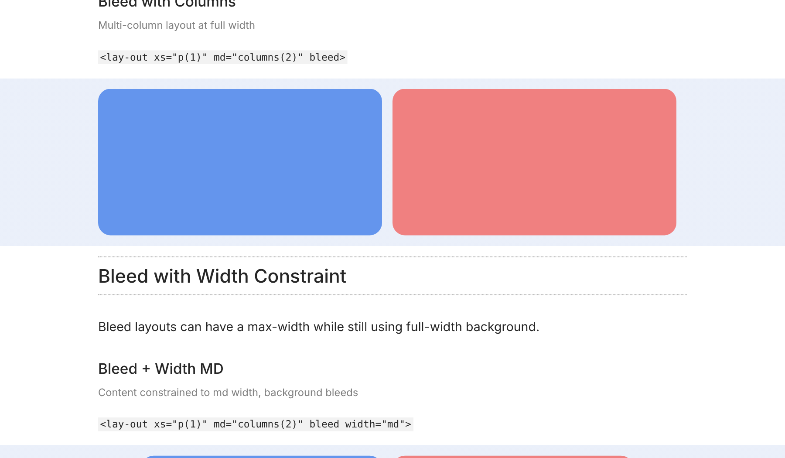
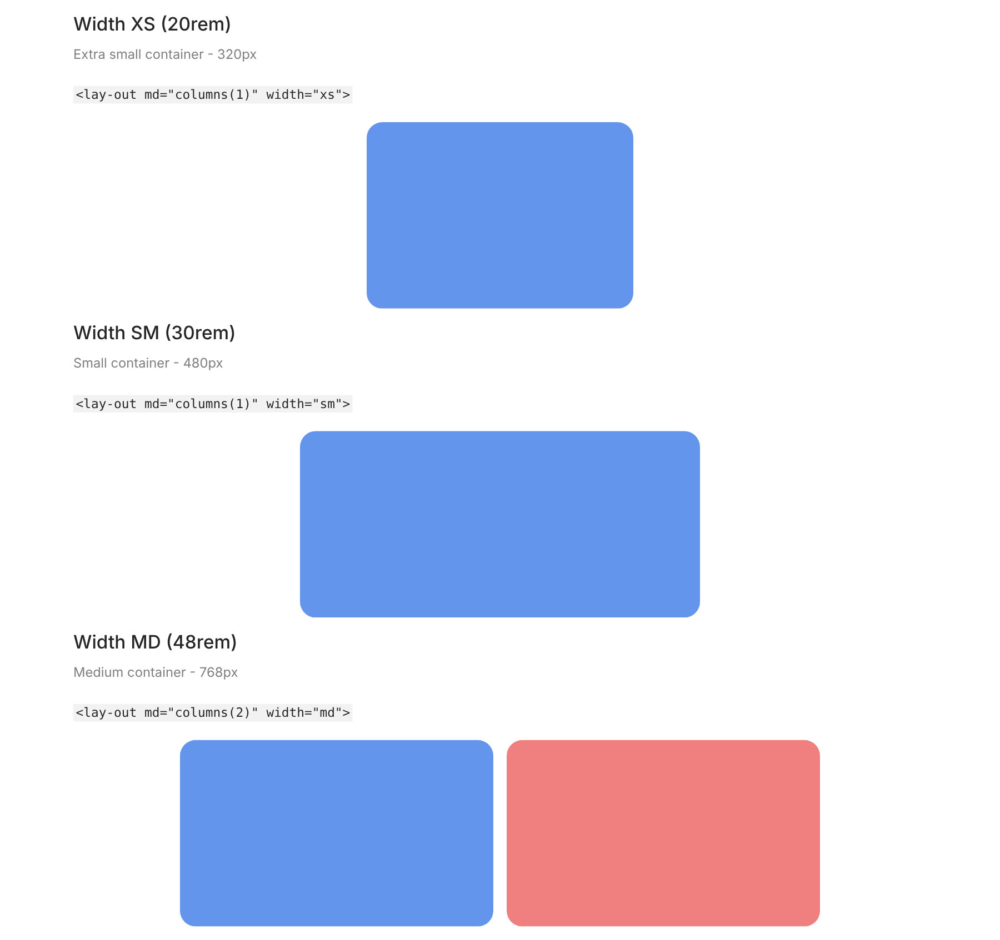
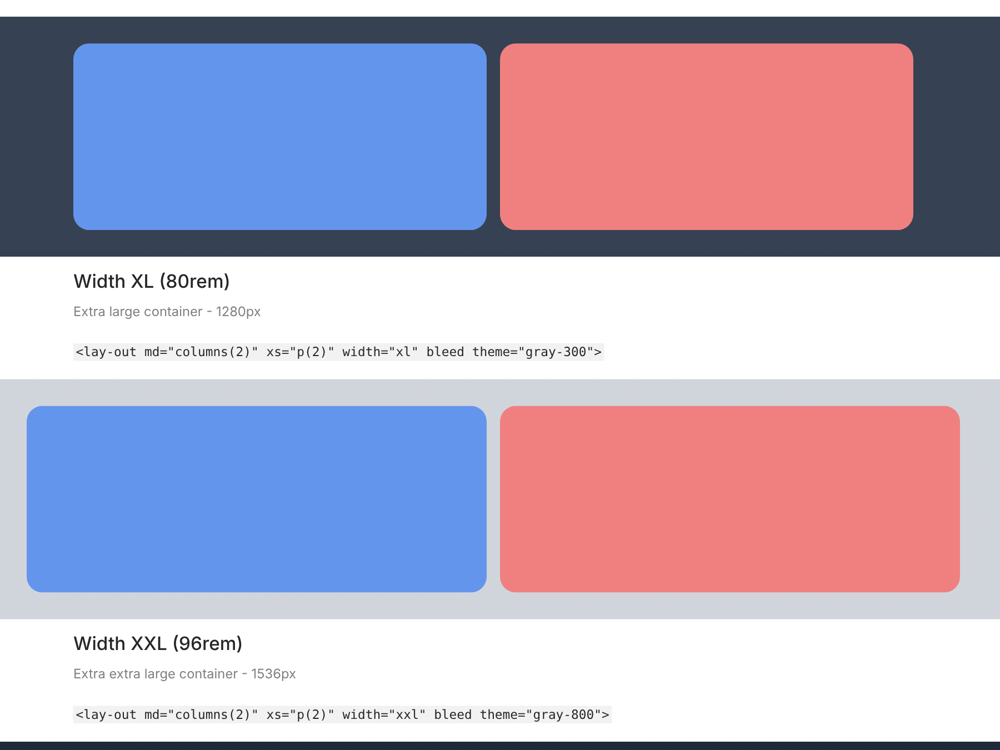

# 6. Bleed and widths

By default every `<lay-out>` sits in the page's content column, which is `--layout-bleed-mw`
wide (1024px by default) with a side gutter of at least `--layout-mi` (1rem). Two attributes
change that: `bleed` lets a section's **background** run edge to edge, and `width` makes the
**content** narrower or wider than the column.

## Bleed: full-width bands

Add `bleed` and the layout's background reaches both edges of the viewport, while its items
stay aligned with the content column:

```html
<lay-out xs="p(1)" md="columns(2)" bleed style="--layout-bg: #ebeffa">
  <div>…</div>
  <div>…</div>
</lay-out>
```



*Screenshot: [`bleed.html`](https://v4.browser.style/layout/dist/bleed.html), "Bleed with Columns", at 1200px.*

This is what makes alternating coloured sections, hero bands and full-width carousels
possible. The background comes from `--layout-bg` or from a
[theme](07-themes-and-sections.md).

### Edge-to-edge content: `bleed="0"`

`bleed="0"` removes the inner alignment as well, so the **items** also run edge to edge.
Use it for full-bleed images, heroes and the `stack(reveal)` effect.

### Offset content: `bleed="10"`, `bleed="-15"`

A number between -100 and 100 moves the content off-centre within the band. A positive value
adds that percentage to the start-side space and removes it from the end side, so the content
moves towards the end. A negative value does the opposite.

```html
<lay-out xs="p(1)" md="columns(1)" bleed="25">
```


*Screenshot: [`bleed.html`](https://v4.browser.style/layout/dist/bleed.html), `bleed="25"`, at 1200px.*

Directions are logical, so the offset mirrors on right-to-left pages.

### Inner padding

`pi()` sets a minimum inline padding inside a bleed band. On narrow screens, where the
band and the column are almost the same width, it keeps the content off the edges:

```html
<lay-out xs="pi(2) pb(1)" md="columns(2)" bleed>
```

## Width: narrower or wider content

`width` limits the layout's content to one of six sizes:

| Value | Max width |
|---|---|
| `xs` | 20rem (320px) |
| `sm` | 30rem (480px) |
| `md` | 48rem (768px) |
| `lg` | 64rem (1024px) |
| `xl` | 80rem (1280px) |
| `xxl` | 96rem (1536px) |

On its own, `width` makes a section narrower than the column and centres it:

```html
<lay-out md="columns(1)" width="sm">
<lay-out md="columns(2)" width="md">
```



*Screenshot: [`widths.html`](https://v4.browser.style/layout/dist/widths.html) at 1200px.*

### Bleed plus width

With `bleed`, `width` sets the content width *inside* the full-width band, and that can be
wider than the normal column. This is how you give one section, like a gallery or a
dashboard, more room than the rest of the page:

```html
<lay-out md="columns(2)" xs="p(2)" width="xl" bleed theme="gray-300">
```



*Screenshot: [`widths.html`](https://v4.browser.style/layout/dist/widths.html) at 1200px, the `width="lg"` and `width="xl"` examples. The
page column is 1024px, so the `xl` content reaches further out than the sections around it.*

## Good to know

- **`bleed` needs the page container.** It works because the layout system centres
  `<body>` (see [Getting started](02-getting-started.md#what-happens-to-the-page)). If your
  own CSS sets `margin`, `max-width` or `padding` on `<body>` outside a cascade layer, that
  wins, and bleed bands no longer reach the edges.
- **Nested layouts don't inherit bleed.** A `<lay-out>` inside a bleed section sizes itself
  to its own cell, so grids inside cards inside a bleed band behave normally.
- **Safari with visible scrollbars.** When scrollbars take up space (macOS "Show scroll
  bars: Always", or a mouse attached), a bleed band is measured against the full viewport.
  The layout system clips the extra sliver in Safari so no horizontal scrollbar appears.
- **Safari needs the `attr()` polyfill** for `bleed="N"` (see
  [Getting started](02-getting-started.md#load-the-css)).

Next: [Themes and sections →](07-themes-and-sections.md)
