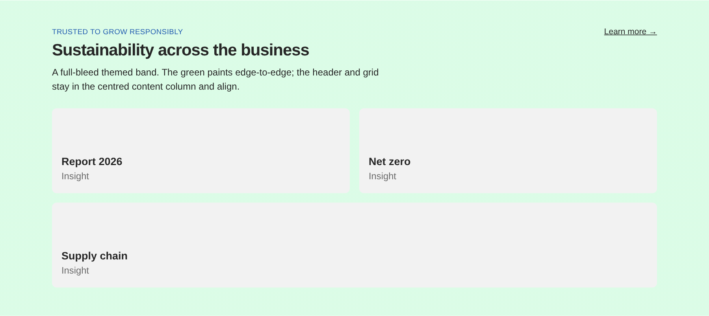
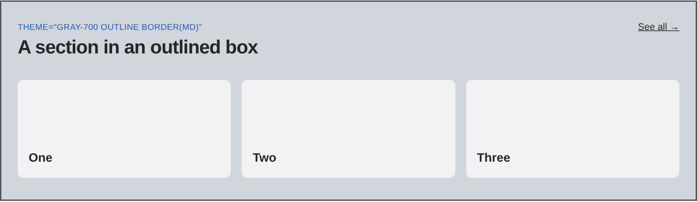

# 7. Themes and sections

## Colouring a section

There are two ways to give a `<lay-out>` a background.

**A theme** uses the shared colour palette from `@browser.style/base`:

```html
<lay-out theme="gray-300" bleed md="columns(2)">
```

**A custom property** takes any colour:

```html
<lay-out style="--layout-bg: #ebeffa; --layout-c: #123" bleed md="columns(2)">
```

Combine either one with [`bleed`](06-bleed-and-widths.md) to paint the colour edge to edge.

### The `theme` attribute

`theme` takes one **colour** and any number of **looks**:

```html
<lay-out theme="green-100">            <!-- a light green background -->
<lay-out theme="gray-800 dark">        <!-- dark grey, and dark mode for everything inside -->
<lay-out theme="gray-300 border">      <!-- grey with a border -->
```

**Colours** are `<hue>-<step>`, such as `green-100`, `gray-800` or `accent-700`: ten hues
plus `accent`, with steps from 50 to 950. `white` and `black` work too. On a dark page,
every step automatically swaps to its mirror, so `green-100` is a light green on a light
page and a dark green on a dark page.

**Looks** change how the colour is applied:

| Look | Effect |
|---|---|
| `ink` | Uses the colour's matching text colour (normally the text stays as it is) |
| `border` | Adds a border and keeps the background |
| `outline` | Removes the background and draws a border in the colour |
| `glass` | A translucent, blurred background |
| `light` / `dark` | Forces light or dark mode for the section and everything in it |

`theme` is the same attribute used on cards, chips and other components, so a dark section
can contain light cards, or the other way round. Each element resolves its own theme. The
full palette and the contrast rules are in [`ui/base/theme.md`](../../ui/base/theme.md).

`--layout-bg` and `--layout-c` take priority over the theme, and `--layout-bdrs` rounds the
section's corners.

## Section headers: `<lay-out-group>`

Most sections need a header above the grid, such as a small label, a title, an intro line
and a "see all" link. `<lay-out-group>` wraps the header and the layout into one section:

```html
<lay-out-group bleed xs="pb(3)" theme="green-100">
  <ui-content>
    <small data-part="eyebrow">Trusted to grow responsibly</small>
    <h2 data-part="headline">Sustainability across the business</h2>
    <p data-part="summary">A full-bleed themed band…</p>
    <a data-part="link" href="/sustainability">Learn more →</a>
  </ui-content>
  <lay-out md="columns(2)" lg="grid(3a)">
    <!-- cards -->
  </lay-out>
</lay-out-group>
```



*Screenshot: `dist/section.html` at 1200px.*

How it fits together:

- **The group carries the section's look.** `bleed`, `theme`, `--layout-bg` and the spacing
  tokens go on `<lay-out-group>`. The inner `<lay-out>` only arranges the items, so don't
  give it its own `bleed` or background.
- **The header isn't a grid item.** It sits above the `<lay-out>`, so every layout pattern
  keeps its item placement.
- **The header is a `<ui-content>`** from `@browser.style/card`, so the label, title and
  summary use the card typography. Load the card CSS on pages that use section headers.
  The `link` part is aligned to the end of the header and moves below the title on narrow
  screens.
- **Spacing:** `pb()`, `pbs()` and `pbe()` are padding inside the band, and `mbs()` and
  `mbe()` are margins outside it.
- **Header width:** the header lines up with the grid. Add `data-bleed` to the
  `<ui-content>` to let it span the whole band.

### A boxed section

Without `bleed`, a themed group is a box in the content column. Add `border` for an outline
and `--layout-bdrs` for rounded corners:

```html
<lay-out-group theme="gray-300 border border(md)" xs="pb(2)"
               style="--layout-bdrs: 0.75rem; padding-inline: 1.5rem">
```



Next: [Animations →](08-animations.md)
