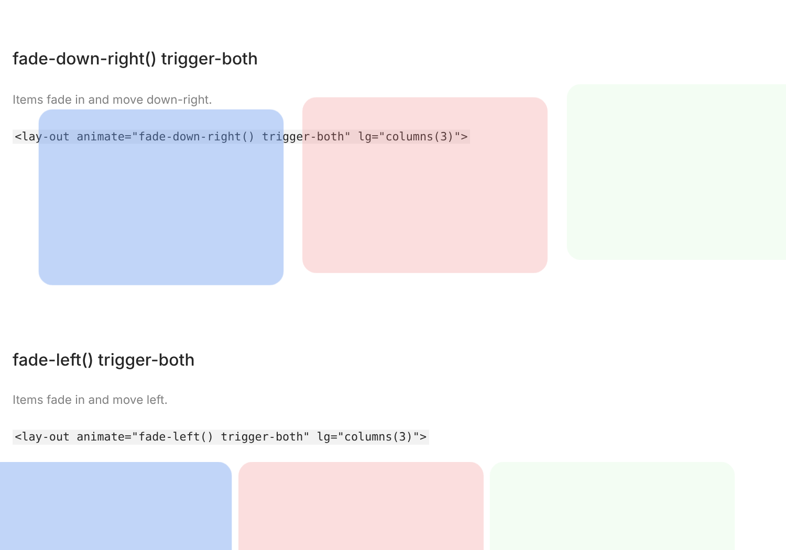
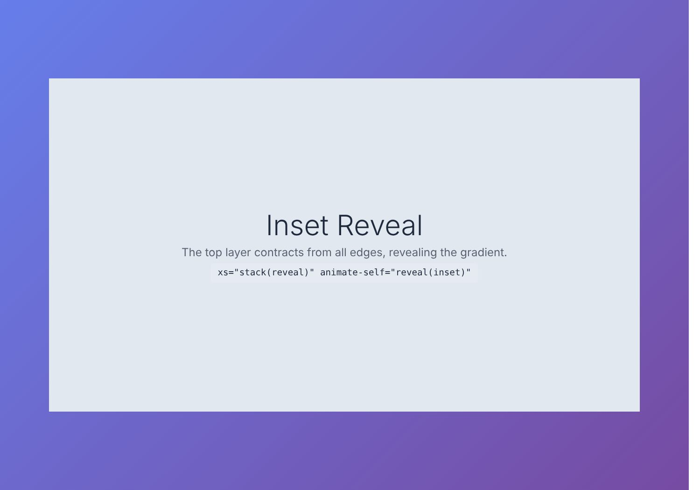

# 8. Animations

Layouts can animate into view as the page scrolls. The animations are pure CSS and driven by
scroll position, and most of them only change `transform` and `opacity`, which browsers can
animate without re-running layout. The engine
lives in `@browser.style/base`, which works on any element, not just `<lay-out>`.

There are two attributes:

| Attribute | Animates |
|---|---|
| `animate-self="…"` | The layout itself, as one block |
| `animate="…"` | Each child, one after another |

## Animating the items

```html
<lay-out animate="fade-down-right() trigger-both" lg="columns(3)">
```



*Screenshot: `dist/animate.html` at 1000px, taken while the section scrolls into view. Each
item is at a different stage, which is the stagger.*

Each child animates as its own row arrives, and siblings are offset slightly, so a row
ripples in instead of appearing all at once.

## Animating the whole section

```html
<lay-out animate-self="fade-up()" lg="grid(3a)">
<lay-out animate-self="fade-right()" animate="fade-up()" lg="grid(3a)">  <!-- both -->
```

## The animations

| Group | Names |
|---|---|
| Fade | `fade-in()` `fade-out()` `fade-up()` `fade-down()` `fade-left()` `fade-right()` and the diagonals, such as `fade-up-left()` |
| Zoom | `zoom-in()` `zoom-out()` `zoom-in-rotate()` `zoom-out-rotate()` |
| Flip | `flip-up()` `flip-down()` `flip-left()` `flip-right()` `flip-diagonal()` |
| Slide | `slide-up()` `slide-down()` `slide-in()` `slide-out()` |
| Bounce | `bounce()` `bounce-in-up()` `bounce-in-down()` `bounce-in-left()` `bounce-in-right()` |
| Reveal | `reveal(circle)` `reveal(inset)` and 31 shape reveals, such as `reveal(hex)` and `reveal(star)` |

A number in the brackets makes the effect stronger: `fade-up(2)`, `zoom-in(3)`.

## Speed, exit and trigger words

Add plain words to the same attribute:

| Word | Effect |
|---|---|
| `very-slow` `slow` `fast` `very-fast` | How much scrolling the animation takes |
| `exit` `exit-fast` `exit-slow` | Also animate out as the section leaves the screen |
| `trigger` | Start the animation when the section scrolls in, then let it play at its own speed instead of following the scroll |
| `trigger-both` `trigger-exit` `trigger-down` `trigger-up` | Variations of `trigger` for leaving, or for one scroll direction |
| `deep` | Animate the grandchildren too, with a two-level stagger |
| `clip` | Clip the section so items sliding in don't cause overflow |

```html
<lay-out animate="fade-up() slow exit" lg="columns(3)">
```

The `easing` attribute picks a curve from base's easing tokens:
`easing="ease-spring-1"`.

## Reveal layers with `stack(reveal)`

`stack(reveal)` combines the [stack layout](04-layouts.md#stack) with a reveal animation.
The section becomes sticky and full height, and as you scroll, the top layer is clipped away
to show the layer beneath:

```html
<lay-out bleed="0" xs="stack(reveal)" animate-self="reveal(inset)">
  <section>…the layer underneath…</section>
  <section>…the layer on top…</section>
</lay-out>
```



*Screenshot: `dist/reveal-stack.html` at 1000px, partway through `reveal(inset)`.*

## Accessibility and support

- **Reduced motion.** When the visitor has asked for reduced motion, every animation is
  removed and elements show in their final state.
- **Progressive enhancement.** Scroll-driven animation works in Chrome and Safari 26+.
  The `trigger` words need scroll-triggered animations (Chrome 145+). Where a feature is
  missing, the content simply appears without animating.
- **Carousels.** On an `overflow` row, stick to `fade-up()`, `fade-down()` and `fade-in()`.
  Sideways effects move the slides' snap points.

The full engine reference, with every option, is in
[`core/animations.md`](../core/animations.md).

Next: [Carousels →](09-carousels.md)
