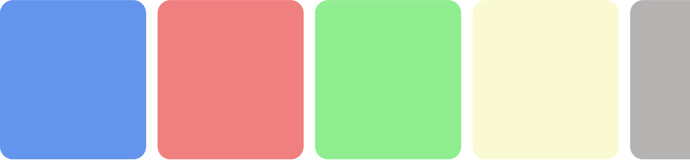
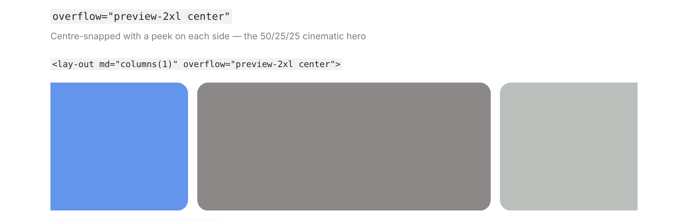
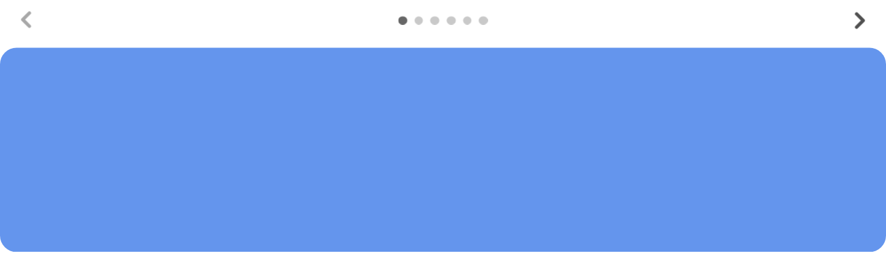

# 9. Carousels

Add `overflow` to any `<lay-out>` and it becomes a horizontal scroller: the items stay in a
single row, and you swipe or scroll through them. The breakpoint layout still decides how
many items fill the view, so `md="columns(2)" lg="columns(4)"` shows two items at a time on
tablets and four on desktops.

```html
<lay-out md="columns(2)" lg="columns(4)" overflow="preview">
```



*Screenshot: [`overflow.html`](https://v4.browser.style/layout/dist/overflow.html) at 1000px.*

## Shaping the scroller: `overflow` tokens

| Token | Effect |
|---|---|
| `preview`, `preview-xs` … `preview-xl` | Leave room to show part of the next item, which tells people there's more. Sizes run from 40px to 200px |
| `preview-2xl` | A peek of 25% of the carousel width |
| `center` | Centre the current item, with a peek on both sides |
| `frame` | Like `center`, but works with two or more items in view |
| `gaps` | Add a gap before the first item and after the last |
| `fade`, `fade-start`, `fade-end` | Fade the edges as you scroll |
| `stop` | Stop at every item, one at a time |
| `none` | Clip instead of scroll |

A centred "cinematic" carousel with a peek on each side:

```html
<lay-out md="columns(1)" overflow="preview-2xl center">
```



*Screenshot: [`overflow.html`](https://v4.browser.style/layout/dist/overflow.html) at 1200px, scrolled to the second slide.*

## Controls: arrows and dots

Controls are set with the `media` attribute, using the same tokens as image carousels in
`@browser.style/card`. Load `@browser.style/carousel` for these.

```html
<lay-out md="columns(1)" overflow media="nav(abv)">
```



*Screenshot: [`carousel.html`](https://v4.browser.style/layout/dist/carousel.html) at 1000px.*

| Token | Effect |
|---|---|
| `nav` | Arrows and dots |
| `nav(arw)` / `nav(mrk)` | Arrows only, or dots only |
| `nav(blw)` / `nav(abv)` | Put the controls in their own band below or above the scroller |
| `arw(…)` | Arrow style, size and position, such as `arw(bare)`, `arw(lg)` or `arw(bc)` |
| `mrk(…)` | Dot style, such as pills `mrk(pll)` or thumbnails `mrk(tmb)` |
| `pages` | One dot per page of items instead of one per item |
| `auto` / `auto(4s)` | Autoplay |
| `loop` | Loop endlessly |

```html
<lay-out bleed md="columns(1)" overflow="preview-2xl center"
         media="nav(blw) arw(bare) mrk(pll) pages auto(4s) loop">
```

[`carousel.html`](https://v4.browser.style/layout/dist/carousel.html) shows every control style. The full token reference is in
[`ui/card/docs/carousel.md`](../../ui/card/docs/carousel.md).

## Browser support

- **Chrome** draws the arrows and dots natively with `::scroll-button()` and
  `::scroll-marker`, without JavaScript.
- **Safari** doesn't support those yet. Load the carousel polyfill
  (`/ui/carousel/polyfill/`), which adds real buttons styled from the same tokens. Without
  it, Safari visitors still get a working swipeable scroller, just without controls.
- **`auto` and `loop`** need the small carousel script from `@browser.style/card`. Without
  it, the carousel is an ordinary scroller.

Next: [Configuration and custom builds →](10-configuration.md)
